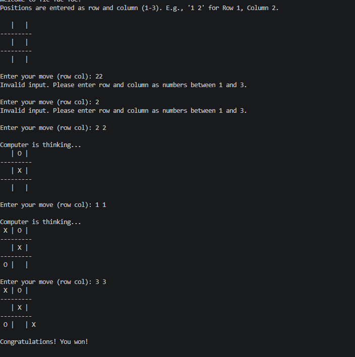

## 1. Tic-Tac-Toe with a simple AI Agent

An interactive 3x3 Tic-Tac-Toe game where a human player competes against a random-choice AI agent.

## 2. Company Sales Data Visualisation (Matplotlib)

Python scripts utilising pandas and matplotlib to analyse and visualise performance metrics from a company dataset.

a. Total Profit Line Plot: A plot of monthly total profit trends over time

b. Product Comparison subplots: Displays side-by-side subplots comparing monthly sales for Bathing soap and face wash.
